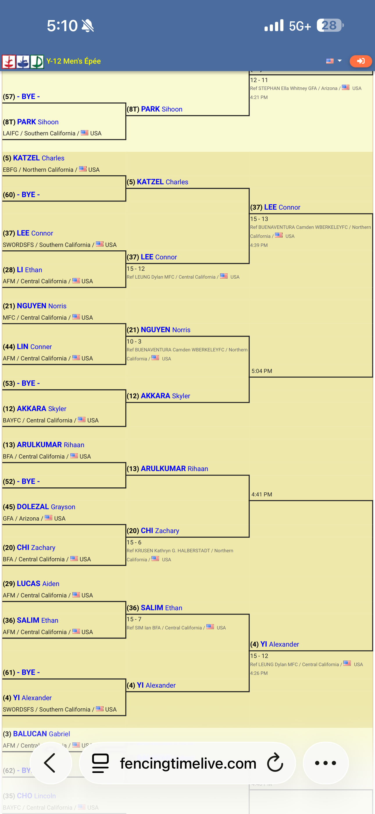

# DE Bracket Photo Extraction - Implementation Plan

## Overview

Extract DE bracket data from phone screenshots using Claude Vision. Unlike pool sheets (single image), DE brackets require **multiple screenshots** that get stitched together.

---

## 1. Two-Phase Extraction Approach

### Phase 1: Per-Image Extraction

Each screenshot is sent individually to Claude Vision. The prompt extracts every visible bout with structural metadata for stitching.

**Claude Vision Prompt:**

```
You are analyzing a screenshot of a fencing Direct Elimination (DE) bracket
displayed on a phone or tablet screen.

Extract EVERY visible bout in this screenshot, including partial/cut-off bouts
at the edges. Return JSON:

{
  "screenshot_metadata": {
    "estimated_total_bracket_size": <64 | 32 | 128 | etc.>,
    "visible_rounds": ["Table of 64", "Table of 32", ...],
    "position_hint": "top-left" | "top-right" | "bottom-left" | "bottom-right" | "center" | "left-half" | "right-half",
    "bracket_format": "single_elimination",
    "software_detected": "FencingTime" | "EnGarde" | "USAFencing" | "unknown"
  },
  "bouts": [
    {
      "bout_id_hint": "<round>-<approximate_position>",
      "round_name": "Table of 64" | "Table of 32" | "Table of 16" | "Table of 8" | "Semi-finals" | "Finals",
      "bracket_position": <1-based position within that round, top to bottom>,
      "fencer_top": {
        "name": "<LAST First>",
        "club": "<club or null>",
        "seed": <number or null>,
        "score": <number or null>
      },
      "fencer_bottom": {
        "name": "<LAST First>",
        "club": "<club or null>",
        "seed": <number or null>,
        "score": <number or null>
      },
      "winner": "top" | "bottom" | null,
      "is_bye": true | false,
      "is_partial": true | false,
      "referee": "<name or null>",
      "time": "<time or null>"
    }
  ],
  "cut_off_names": ["<any names visible but whose bout is not fully readable>"]
}

IMPORTANT:
- Extract ALL visible bouts, not just one fencer's path
- "bracket_position" counts from top of bracket: position 1 is the topmost bout in that round
- For byes, set is_bye=true, the advancing fencer in fencer_top, and fencer_bottom name as "BYE"
- If a bout is partially cut off at the edge of the screenshot, set is_partial=true and fill in what you can see
- Seed numbers appear in parentheses like (4) or #4
- The winner typically has the higher score, or their name may be bold/highlighted
- Score format varies: "15-7", "V15-7", or just the scores next to each name
- If you cannot read a name or score, use null
```

Key fields:

- `bracket_position` — vertical ordering for matching bouts across images
- `position_hint` — helps the merge step understand spatial relationships
- `is_partial` — flags edge bouts that may appear complete in another screenshot
- `cut_off_names` — catches names visible at edges but without full bout context

### Phase 2: Multi-Image Merge (Text-Only)

After extracting from each image individually, send all extracted JSON results (no images) to Claude in a single text-only call to merge and deduplicate.

**Merge Prompt:**

```
You are merging DE bracket data extracted from multiple screenshots of the same
fencing tournament bracket. The screenshots overlap -- some bouts appear in
multiple screenshots.

Here are the extractions from {N} screenshots:

Screenshot 1: {json_1}
Screenshot 2: {json_2}
...

Merge these into a single complete bracket. Rules:
1. DEDUPLICATE: If the same bout appears in multiple screenshots (same fencer
   names and round), keep the version with more complete data (non-null scores,
   non-partial)
2. RESOLVE CONFLICTS: If two screenshots show different scores for the same bout,
   prefer the one marked is_partial=false
3. RENUMBER: Assign correct bracket_position values (1-based, top to bottom) for
   each round
4. VALIDATE TREE: Winners of adjacent bouts in round N should appear as fencers
   in round N+1. Flag any inconsistencies.
5. Identify the fencer named "{our_fencer_name}" (or closest match) and mark
   their path through the bracket.

Return:
{
  "tournament_bracket": {
    "bracket_size": <64 | 32 | 128>,
    "total_bouts_extracted": <number>,
    "completeness": <0.0-1.0, fraction of expected bouts that were captured>,
    "rounds": {
      "Table of 64": [ ...bouts ordered by bracket_position... ],
      "Table of 32": [ ...bouts... ],
      ...
    }
  },
  "our_fencer": {
    "name": "<matched name>",
    "seed": <number>,
    "path": [
      {
        "round_name": "Table of 64",
        "opponent_name": "<name>",
        "opponent_seed": <number>,
        "opponent_club": "<club>",
        "score_for": <number>,
        "score_against": <number>,
        "result": "won" | "lost"
      }
    ],
    "final_placement_range": "Top 32" | "Top 16" | etc.
  },
  "warnings": ["<any inconsistencies or missing data>"],
  "duplicate_bouts_removed": <count>
}
```

**Why two phases:**

- Sending 3-8 high-resolution images in a single API call would be very expensive and may exceed token limits
- The merge step is text-only, so it is cheap
- Each image extraction is independent and can be parallelized

---

## 2. Python Extraction Functions

New file: `de_extraction.py`

### `extract_de_bracket_from_photo(image_path)`

Single-image extraction. Same structure as `extract_pool_results_from_photo()`:

- Read file, base64-encode, detect media type
- Call `claude_client.messages.create()` with `model="claude-sonnet-4-6"`, `max_tokens=4096` (higher than pool's 2048 because brackets have more data)
- Parse JSON response with the same markdown backtick fallback
- Returns the per-screenshot JSON structure

### `merge_de_bracket_extractions(extractions, our_fencer_name)`

Text-only merge call:

- Takes a list of per-image extraction dicts and the fencer's name
- Calls `claude_client.messages.create()` with `max_tokens=8192` (full brackets can be large)
- Returns the merged bracket structure

### `extract_full_de_bracket(image_paths, our_fencer_name, tournament_id)`

Orchestration function:

- Calls `extract_de_bracket_from_photo()` for each image sequentially (3-8 images)
- Calls `merge_de_bracket_extractions()` with all results
- Returns the merged bracket plus the `our_fencer` path
- For 128+ brackets with 6+ images: merge in two phases (groups of 3-4 first, then merge the merged results) to stay under token limits

---

## 3. Database Models

### `Tournament` model (shared with pool extraction -- add to `database.py`)

This is a prerequisite for both pool and DE features. Created once per event, then referenced by all pool/DE uploads at that tournament.

```python
class Tournament(Base):
    __tablename__ = 'tournaments'
    id = Column(Integer, primary_key=True)
    name = Column(String(255), nullable=False)       # e.g. "South Point Y12 Epee"
    location = Column(String(255))                   # e.g. "Las Vegas, NV"
    date = Column(DateTime, nullable=False)
    weapon = Column(String(10), default='epee')      # epee/foil/sabre
    age_category = Column(String(20))                # Y10, Y12, Y14, Cadet, Junior, etc.
    level = Column(String(20))                       # Local, Regional, National, International
    notes = Column(Text)
    created_at = Column(DateTime, default=datetime.utcnow)
```

**Tournament CRUD endpoints (in `app.py`):**

| Method | Route                          | Purpose                                    |
| ------ | ------------------------------ | ------------------------------------------ |
| POST   | `/api/tournaments`             | Create tournament                          |
| GET    | `/api/tournaments`             | List all tournaments (most recent first)   |
| GET    | `/api/tournaments/<id>`        | Get single tournament with pool/DE summary |
| POST   | `/api/tournaments/<id>`        | Update tournament                          |
| POST   | `/api/tournaments/<id>/delete` | Delete tournament (cascades pool/DE data)  |

**Tournament selection UI** (shared by pool and DE upload pages):

- Dropdown at top of upload form: "Select Tournament"
- Lists recent tournaments by date
- "+ New Tournament" option opens an inline form with: name, date, location, level
- **Weapon defaults to Epee** and **age category defaults to Y12** (Ethan's current profile) -- these are pre-filled but editable in case they change
- Once created, the tournament is selected and pool/DE uploads link to it
- Only needs to be done once per event -- all uploads at that tournament share the same `tournament_id`

### `DEBracket` model (add to `database.py`)

```python
class DEBracket(Base):
    __tablename__ = 'de_brackets'
    id = Column(Integer, primary_key=True)
    tournament_id = Column(Integer, index=True)
    bracket_size = Column(Integer)            # 32, 64, 128
    completeness = Column(String(10))         # "0.85" etc.
    bracket_json = Column(Text)               # Full merged bracket
    our_fencer_path_json = Column(Text)       # Just our fencer's path
    created_at = Column(DateTime, default=datetime.utcnow)
```

### `save_de_results_to_db(tournament_id, bracket_data)`

```python
def save_de_results_to_db(tournament_id, bracket_data):
    db = get_db()
    try:
        # Save our fencer's path as elimination_round records
        for bout in bracket_data['our_fencer']['path']:
            elim_round = EliminationRound(
                tournament_id=tournament_id,
                round_name=bout['round_name'],
                opponent_name=bout['opponent_name'],
                opponent_club=bout.get('opponent_club'),
                opponent_seed=bout.get('opponent_seed'),
                score_for=bout['score_for'],
                score_against=bout['score_against'],
                result=bout['result'],
                notes=None
            )
            db.add(elim_round)

        # Save full bracket as JSON for future analytics
        de_bracket = DEBracket(
            tournament_id=tournament_id,
            bracket_size=bracket_data['tournament_bracket']['bracket_size'],
            completeness=str(bracket_data['tournament_bracket']['completeness']),
            bracket_json=json.dumps(bracket_data['tournament_bracket']),
            our_fencer_path_json=json.dumps(bracket_data['our_fencer'])
        )
        db.add(de_bracket)
        db.commit()
    except Exception as e:
        db.rollback()
        raise e
    finally:
        db.close()
```

---

## 4. Flask API Endpoints

### `POST /api/upload-de-bracket`

Multi-image upload endpoint:

```python
@app.route('/api/upload-de-bracket', methods=['POST'])
@login_required
def upload_de_bracket():
    if 'photos' not in request.files:
        return jsonify({'error': 'No photos uploaded'}), 400

    tournament_id = request.form.get('tournament_id')
    our_fencer_name = request.form.get('fencer_name', 'SALIM Ethan')

    files = request.files.getlist('photos')
    if not files or files[0].filename == '':
        return jsonify({'error': 'No files selected'}), 400

    saved_paths = []
    try:
        for file in files:
            filename = secure_filename(file.filename)
            filepath = app.config['UPLOAD_FOLDER'] / f"de_{filename}"
            file.save(filepath)
            saved_paths.append(filepath)

        bracket_data = extract_full_de_bracket(
            saved_paths, our_fencer_name, tournament_id
        )

        return jsonify({
            'success': True,
            'extracted_data': bracket_data,
            'images_processed': len(saved_paths)
        })
    except Exception as e:
        return jsonify({'error': str(e)}), 500
    finally:
        for path in saved_paths:
            if path.exists():
                path.unlink()
```

### `POST /api/confirm-de-results`

Save confirmed results after user review:

```python
@app.route('/api/confirm-de-results', methods=['POST'])
@login_required
def confirm_de_results():
    data = request.get_json()
    tournament_id = data.get('tournament_id')
    bracket_data = data.get('bracket_data')

    if not all([tournament_id, bracket_data]):
        return jsonify({'error': 'Missing required fields'}), 400

    try:
        save_de_results_to_db(tournament_id, bracket_data)
        return jsonify({'success': True})
    except Exception as e:
        return jsonify({'error': str(e)}), 500
```

---

## 5. Mobile HTML UI

New template: `templates/de_bracket.html`

### Upload Flow

**Tournament selector** (at top of form):

- Dropdown populated from `GET /api/tournaments` (most recent first)
- If a tournament was already created for today's event (e.g., from a pool upload), it's auto-selected
- If no tournament exists yet, the user taps "+ New Tournament" and fills in: name, date, location, weapon, age category
- This only needs to happen once per event

**Screenshot upload:**

```html
<input
  type="file"
  id="bracketPhotos"
  accept="image/*"
  multiple
  capture="environment"
/>
```

- `multiple` attribute allows selecting several screenshots
- Thumbnail previews of selected images with reorder/remove capability
- Counter: "3 screenshots selected"
- "Extract Bracket" button uploads all images at once
- Processing state: "Extracting image 2 of 5..." then "Merging bracket data..."

### Review/Confirm Screen

**Our Fencer's Path (primary view):**

Vertical timeline of each DE bout in card style:

```
[Card] Table of 64
  SALIM Ethan (36) vs LUCAS Aiden (29)
  Score: 15-7  WIN

[Card] Table of 32
  SALIM Ethan (36) vs YI Alexander (4)
  Score: 7-15  LOSS

Final: Top 32
```

Each card is editable -- tap opponent name, scores, or result to correct.

**Full Bracket View:**

Collapsible "View Full Bracket" section showing all rounds in a simplified table format:

```
Table of 64 (32 bouts, 28 extracted)
  (1) CHAN Nathan vs BYE         -> CHAN Nathan
  (2) SMITH John  vs DOE Jane   -> SMITH John 15-8
  ...
```

**Completeness indicator:**

"Bracket completeness: 85% (54 of 63 bouts captured)" -- helps decide if more screenshots are needed.

**Action buttons:**

- "Confirm & Save" -- saves to database
- "Upload More Screenshots" -- returns to upload, preserving already-extracted data
- "Cancel" -- discards everything

---

## 6. Edge Cases

| Case                                | Handling                                                              |
| ----------------------------------- | --------------------------------------------------------------------- |
| Multiple screenshots of same region | Merge deduplicates via fencer names + round + bracket_position        |
| Partial overlaps (20-40%)           | `is_partial` flag; merge prefers complete versions                    |
| Blurry screenshots                  | Claude returns `null` for unreadable fields; UI highlights in yellow  |
| Identifying "our fencer"            | Fuzzy match on `our_fencer_name`; if no match, user selects from list |
| BYEs                                | `is_bye=true`, no scores; save function skips BYE bouts               |
| Incomplete brackets                 | Completeness score; warning if < 0.7; "Upload More" button            |
| Different bracket software          | Prompt asks Claude to detect and adapt; `software_detected` field     |
| Very large brackets (128+)          | Two-phase merge: groups of 3-4 first, then merge the merges           |
| Re-uploading same tournament        | Check if DE results exist; warn before overwriting                    |

---

## 7. Cost Estimate

**Per-screenshot image extraction:**

- ~2,500 tokens input, ~1,000-3,000 tokens output
- Cost per image: ~$0.038

**Merge call (text only):**

- ~2,000-8,000 tokens input, ~3,000-6,000 tokens output
- Cost: ~$0.09

| Bracket Size | Screenshots | Image Calls | Merge | Total  |
| ------------ | ----------- | ----------- | ----- | ------ |
| Table of 32  | 2           | $0.076      | $0.06 | ~$0.14 |
| Table of 64  | 4           | $0.15       | $0.09 | ~$0.24 |
| Table of 128 | 8           | $0.30       | $0.18 | ~$0.48 |

Combined with pool photo extraction (~$0.005), a full tournament's data entry costs under $0.25-$0.50.

---

## 8. Implementation Sequence

1. Add `Tournament` model to `database.py` + CRUD endpoints and helper functions (shared prerequisite for both pool and DE features)
2. Add `DEBracket` and `EliminationRound` models to `database.py`
3. Create `de_extraction.py` with the three extraction functions
4. Add `save_de_results_to_db()` to `database.py`
5. Add API routes to `app.py` (tournament CRUD + DE upload/confirm)
6. Create `templates/de_bracket.html` (tournament selector + upload + review UI)
7. Add "DE Brackets" navigation link to `index.html`
8. Test with real bracket screenshots and tune prompts

Step 1 should be done first since both pool and DE depend on it. Steps 2-4 can be done in parallel with step 6.

---

## Critical Files

- `database.py` -- Add DEBracket model, EliminationRound model, save function
- `de_extraction.py` -- New file: all extraction and merge functions
- `app.py` -- Add two new API endpoints
- `templates/de_bracket.html` -- New file: multi-image upload and bracket review UI
- `FUTURE_DATABASE_MODEL.md` -- Reference for existing patterns


