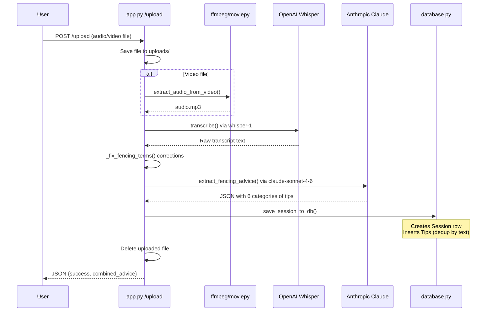
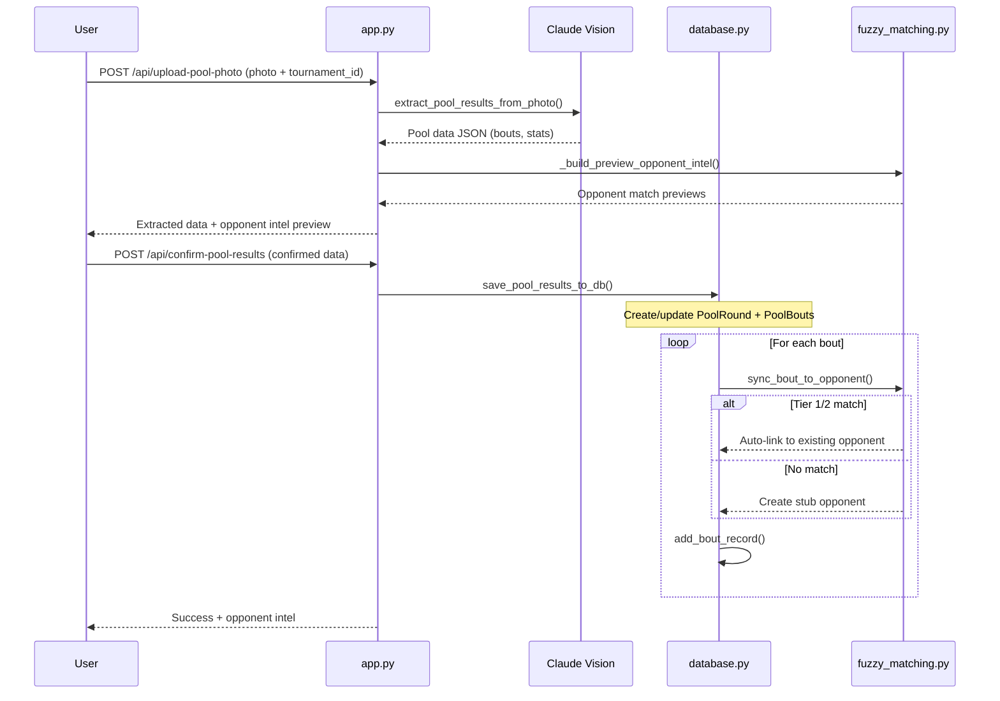
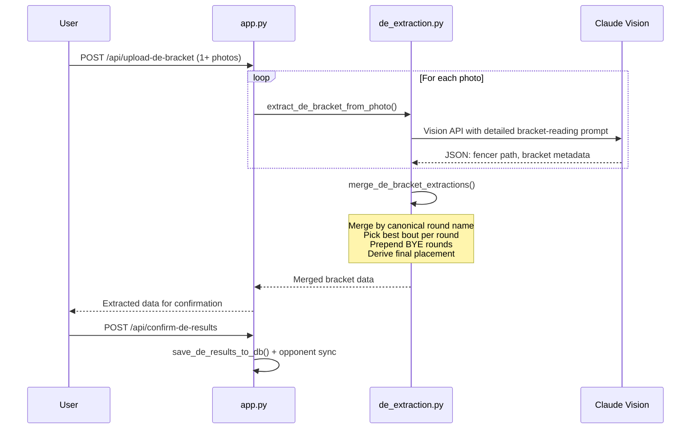
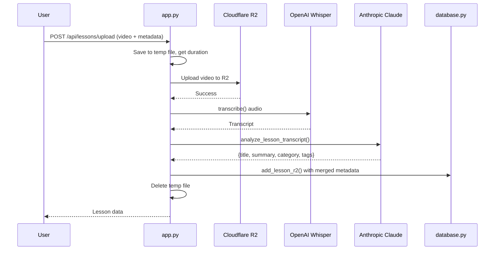

# Endpoints and Routes

## Authentication

All routes except `/login` are protected by the `@login_required` decorator (app.py:304). Authentication uses a single shared password stored in the `APP_PASSWORD` environment variable. Sessions persist for 1 day (`PERMANENT_SESSION_LIFETIME`).

| Method | Path | Purpose |
|--------|------|---------|
| GET/POST | `/login` | Password login form |
| GET | `/logout` | Clear session and redirect to login |

## Page Routes

These routes render Jinja2 templates. All require authentication.

| Method | Path | Template | Purpose |
|--------|------|----------|---------|
| GET | `/` | `index.html` | Home page / navigation hub |
| GET | `/tips` | `tips.html` | View all coaching tips + upload voice memos |
| GET | `/lessons` | `lessons.html` | Private lesson video library |
| GET | `/tournaments` | `tournaments.html` | Tournament list |
| GET | `/tournaments/<id>` | `tournament_detail.html` | Single tournament detail |
| GET | `/opponents` | `opponents.html` | Opponent directory |
| GET | `/opponents/<id>` | `opponent_profile.html` | Opponent profile with head-to-head |
| GET | `/opponents/<id>/intel` | `opponent_intel.html` | Pre-bout intel briefing |
| GET | `/bout-library` | `bout_library.html` | Scout bout video library |

## API Endpoints

All API endpoints require authentication and return JSON.

### Tips / Voice Memos

| Method | Path | Purpose | Key Functions |
|--------|------|---------|---------------|
| POST | `/upload` | Upload voice memo/video, transcribe, extract tips | `transcribe()`, `extract_fencing_advice()`, `save_session_to_db()` |
| GET | `/api/data` | Get all tips and sessions as JSON | `load_data_from_db()` |
| POST | `/api/edit-tip` | Edit a tip's text | `update_tip_in_db()` |
| POST | `/api/delete-tip` | Delete a tip | `delete_tip_from_db()` |
| GET | `/api/backup` | Download full DB backup as JSON | `load_data_from_db()` |
| POST | `/api/restore` | Restore DB from backup JSON | `restore_data_to_db()` |

### Lessons

| Method | Path | Purpose |
|--------|------|---------|
| POST | `/api/add-lesson` | Add lesson with YouTube URL (legacy) |
| POST | `/api/delete-lesson` | Delete legacy lesson |
| POST | `/api/lessons/upload` | Upload video to R2, transcribe, auto-analyze |
| GET | `/api/lessons/list` | List lessons with filtering (category, tag, search) |
| GET | `/api/lessons/<id>` | Get single lesson |
| GET | `/api/lessons/<id>/playback-url` | Generate presigned R2 URL (1hr expiry) |
| POST | `/api/lessons/<id>/update` | Update lesson metadata |
| POST | `/api/lessons/<id>/delete` | Delete lesson + R2 object |
| POST | `/api/lessons/<id>/tags` | Add tags to lesson |
| POST | `/api/lessons/<id>/tags/remove` | Remove a tag |
| GET | `/api/tags` | List all unique tags |

### Tournaments

| Method | Path | Purpose |
|--------|------|---------|
| POST | `/api/tournaments` | Create tournament |
| GET | `/api/tournaments` | List all tournaments |
| GET | `/api/tournaments/<id>` | Get tournament detail |
| POST | `/api/tournaments/<id>` | Update tournament |
| POST | `/api/tournaments/<id>/delete` | Delete tournament (cascading) |

### Tournament Photos

| Method | Path | Purpose |
|--------|------|---------|
| POST | `/api/tournaments/<id>/photos` | Upload photo to R2 |
| GET | `/api/tournament-photos/<id>/playback` | Presigned R2 URL for photo |
| POST | `/api/tournament-photos/<id>/delete` | Delete photo from DB + R2 |

### Pool Results

| Method | Path | Purpose |
|--------|------|---------|
| POST | `/api/upload-pool-photo` | Upload pool sheet photo, extract via Claude Vision |
| POST | `/api/confirm-pool-results` | Save confirmed pool results to DB |

### DE (Direct Elimination) Bracket

| Method | Path | Purpose |
|--------|------|---------|
| POST | `/api/upload-de-bracket` | Upload DE bracket photos, extract via Claude Vision |
| POST | `/api/confirm-de-results` | Save confirmed DE results to DB |
| GET | `/api/tournaments/<id>/de-results` | Get saved DE results |

### DE Prep Tips

| Method | Path | Purpose |
|--------|------|---------|
| POST | `/api/tournaments/<id>/de-prep-tips` | Generate AI tips from pool data |
| GET | `/api/tournaments/<id>/de-prep-tips` | Get saved prep tips |

### DE Summary

| Method | Path | Purpose |
|--------|------|---------|
| POST | `/api/tournaments/<id>/de-summary` | Generate AI DE performance summary |
| GET | `/api/tournaments/<id>/de-summary` | Get saved summary |

### Final Results

| Method | Path | Purpose |
|--------|------|---------|
| POST | `/api/upload-final-results` | Upload final standings photos, extract via Claude Vision |
| POST | `/api/confirm-final-results` | Save final results + generate tournament narrative |

### Tournament Summary

| Method | Path | Purpose |
|--------|------|---------|
| POST | `/api/tournaments/<id>/regenerate-summary` | Regenerate Claude narrative |
| GET | `/api/tournaments/<id>/summary` | Get stored summary |

### Bout Videos

| Method | Path | Purpose |
|--------|------|---------|
| POST | `/api/pool-bouts/<id>/videos` | Upload video for pool bout |
| POST | `/api/elimination-rounds/<id>/videos` | Upload video for DE bout |
| GET | `/api/bout-videos/<id>` | Get presigned R2 playback URL |
| POST | `/api/bout-videos/<id>/delete` | Delete bout video |

### Opponents

| Method | Path | Purpose |
|--------|------|---------|
| POST | `/api/opponents` | Create opponent |
| GET | `/api/opponents` | List all opponents |
| GET | `/api/opponents/<id>` | Get opponent with head-to-head |
| POST | `/api/opponents/<id>` | Update opponent |
| POST | `/api/opponents/<id>/delete` | Delete opponent (cascading) |
| POST | `/api/opponents/<keep_id>/merge/<remove_id>` | Merge two opponents |
| GET | `/api/opponents/search?q=` | Fuzzy name search |
| GET | `/api/opponents/filter?handedness=&...` | Filter by traits |
| POST | `/api/opponents/lookup` | Batch fuzzy name lookup |
| GET | `/api/opponents/<id>/intel` | Pre-bout intel JSON |

### Tactical Notes

| Method | Path | Purpose |
|--------|------|---------|
| POST | `/api/opponents/<id>/notes` | Add tactical note |
| POST | `/api/opponents/<id>/notes/<nid>` | Update note |
| POST | `/api/opponents/<id>/notes/<nid>/delete` | Delete note |
| POST | `/api/opponents/<id>/notes/<nid>/validate` | Increment validated count |
| POST | `/api/opponents/<id>/notes/<nid>/invalidate` | Increment invalidated count |

### Bout Records

| Method | Path | Purpose |
|--------|------|---------|
| POST | `/api/opponents/<id>/bouts` | Add historical bout record |

### Scout Bouts (Bout Library)

| Method | Path | Purpose |
|--------|------|---------|
| POST | `/api/scout-bouts` | Create scout bout |
| GET | `/api/scout-bouts` | List scout bouts (filterable) |
| GET | `/api/scout-bouts/<id>` | Get scout bout with videos |
| POST | `/api/scout-bouts/<id>` | Update scout bout |
| POST | `/api/scout-bouts/<id>/delete` | Delete scout bout + videos |
| POST | `/api/scout-bouts/<id>/videos` | Upload scout video clips |
| GET | `/api/scout-videos/<id>/playback` | Presigned R2 playback URL |
| POST | `/api/scout-videos/<id>` | Update clip notes/order |
| POST | `/api/scout-videos/<id>/delete` | Delete scout video |

## Key Sequence Diagrams

### Voice Memo Upload Flow

### Pool Photo Extraction and Save Flow

### DE Bracket Extraction Flow

### Lesson Upload Flow

