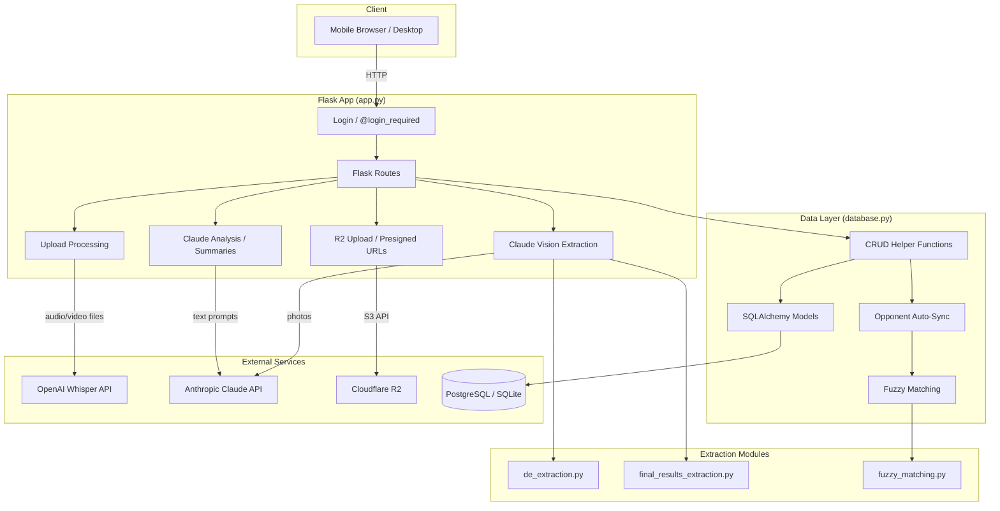

# Architecture Overview

## What This App Does

A personal fencing coach assistant built for Ethan Salim, a Y-12 epee fencer. The app ingests coaching voice memos, tournament results (via photo extraction), lesson videos, and opponent scouting data -- then uses AI to transcribe, categorize, analyze, and generate actionable tactical advice.

## Tech Stack

| Layer | Technology | Purpose |
|-------|-----------|---------|
| Web Framework | Flask (Python) | Routes, templates, API endpoints |
| ORM | SQLAlchemy | Database models, queries |
| Database | PostgreSQL (prod) / SQLite (dev) | All persistent data |
| AI - Transcription | OpenAI Whisper API | Voice memo and video transcription |
| AI - Analysis | Anthropic Claude Sonnet 4.6 | Tip extraction, lesson analysis, DE/pool/final results photo reading, tournament summaries, DE prep tips |
| Object Storage | Cloudflare R2 (S3-compatible) | Lesson videos, bout videos, scout videos, tournament photos |
| Fuzzy Matching | thefuzz (python-Levenshtein) | Opponent name/club deduplication |
| Video Processing | ffmpeg / moviepy | Audio extraction from uploaded videos |
| Deployment | Render (gunicorn) | Production hosting with auto-deploy |
| Frontend | Jinja2 templates + vanilla JS | Server-rendered HTML pages |

## System Architecture



## File Structure

```
/Users/Christine/Fencing/
  app.py                  # ~2440 lines — all Flask routes, AI prompts, upload handling
  database.py             # ~3000 lines — 19 SQLAlchemy models, all CRUD helpers, opponent sync
  de_extraction.py        # ~430 lines — Claude Vision DE bracket photo extraction + merge
  final_results_extraction.py  # ~215 lines — Claude Vision final results extraction
  fuzzy_matching.py       # ~200 lines — thefuzz-based opponent name/club matching
  templates/
    index.html            # Home page (navigation hub)
    login.html            # Password login
    tips.html             # Coaching tips by category + voice memo upload
    lessons.html          # Private lesson video library
    tournaments.html      # Tournament list
    tournament_detail.html # Single tournament: pools, DEs, summary, photos
    opponents.html        # Opponent directory
    opponent_profile.html # Single opponent: traits, notes, head-to-head
    opponent_intel.html   # Pre-bout intel briefing (phone-glance view)
    bout_library.html     # Scout bout video library
  render.yaml             # Render deployment config
  Procfile                # gunicorn start command
  requirements.txt        # Python dependencies
  fencing_data.db         # Local SQLite database (dev only)
  uploads/                # Temp directory for file processing (auto-created)
```

## Key Architectural Decisions

### Lazy API Client Initialization (app.py:106-128)

All three external clients (OpenAI, Anthropic, Cloudflare R2) are initialized lazily via `get_*_client()` functions rather than at module scope. This is required because Render needs the app to boot before environment variables are injected. If clients were instantiated at import time, the app would crash on deploy.

### Monolithic Route File

All ~65 Flask routes live in `app.py`. There is no Blueprint separation. This works because there is a single developer and single user. The routes are organized by feature area with comment headers.

### No ORM Relationships

SQLAlchemy models use integer columns (e.g., `tournament_id`, `opponent_id`) without formal `ForeignKey` or `relationship()` declarations. Joins and cascading deletes are handled manually in helper functions. This simplifies the model definitions but means referential integrity is enforced in application code, not at the database level.

### JSON-in-Text Columns

Several models store structured data as JSON strings in `Text` columns (e.g., `Tip` advice, `DEBracket` bracket data, `ScoutBout` tags, `Opponent` name/club aliases). Helper functions `_parse_json_list()` and `_serialize_json_list()` handle serialization. This avoids needing PostgreSQL-specific JSON columns while staying SQLite-compatible.

### Auto-Migration at Import Time

`database.py` runs `Base.metadata.create_all(engine)` at import time (line 326), which creates any new tables automatically. For existing table schema changes, manual `ALTER TABLE` migration blocks run immediately after (lines 330-404). This means adding a new model is zero-effort, but modifying an existing column requires writing a migration block.

### Two-Phase Opponent Sync

When pool/DE results are saved, opponent matching runs in a separate phase after the bout data is committed (e.g., `save_pool_results_to_db` at line 994). This ensures sync failures never roll back successfully-saved bout data. The sync either auto-links (Tier 1/2 match) or creates a stub opponent record.
