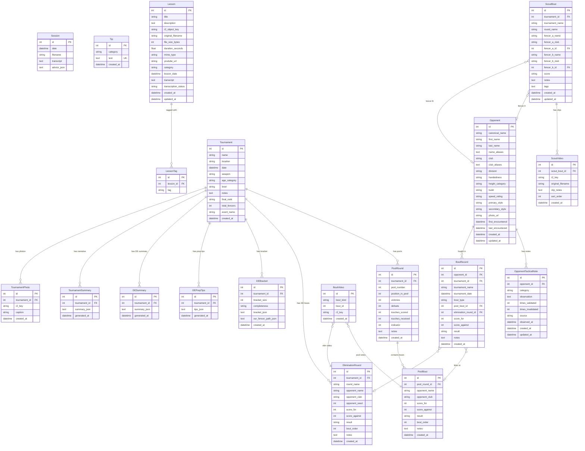

# Data Model

## Overview

The app uses 19 SQLAlchemy models defined in `database.py`. The database is PostgreSQL in production (via Render) and SQLite for local development. The `get_database_url()` function (database.py:311) handles URL resolution and the `postgres://` to `postgresql://` rewrite that SQLAlchemy requires.

All models use integer primary keys. There are no formal SQLAlchemy `ForeignKey` or `relationship()` declarations -- referential integrity is enforced in application-level helper functions.

## Entity Relationship Diagram

## Model Details

### Tips Domain (Coaching Voice Memos)

**Session** (database.py:15) -- One row per uploaded voice memo or video. Stores the original filename, full transcript, and the raw Claude-extracted advice as a JSON string.

**Tip** (database.py:26) -- Individual coaching tip extracted from sessions. Has a `UNIQUE` constraint on `text` to prevent duplicate tips across sessions. The six fixed categories are: `patience_and_control`, `distance_management`, `reading_opponent`, `when_ahead`, `attack_execution`, `defense_and_retreat`.

### Lessons Domain (Private Lesson Videos)

**Lesson** (database.py:36) -- Private lesson video with R2 storage. Supports both legacy YouTube URLs and direct R2 video upload. Includes auto-transcription via Whisper and auto-analysis via Claude (title, summary, category, tags). The `transcription_status` field tracks: `pending`, `complete`, `failed`.

**LessonTag** (database.py:66) -- Tags associated with lessons. Tags are stored lowercase and deduplicated per lesson.

### Tournament Domain

**Tournament** (database.py:75) -- A fencing tournament. Core fields are name, date, location, weapon (default: `epee`), and age_category (default: `Y12`). Phase 5 added `final_rank`, `total_fencers`, and `event_name` columns for final results tracking.

**PoolRound** (database.py:95) -- Aggregate pool performance for a tournament. One pool round per tournament. Stores victories, defeats, touches scored/received, and indicator.

**PoolBout** (database.py:177) -- Individual bout within a pool round. Stores opponent name/club, scores, result (`won`/`lost`), and bout order.

**DEPrepTips** (database.py:112) -- AI-generated pre-DE tactical tips based on pool performance. Stored as a JSON array of 5 tip objects, each with priority, category, and tip text.

**EliminationRound** (database.py:122) -- Single DE bout. Records opponent name/club/seed, scores, result, and round name (e.g., "Table of 16", "Semi-Finals").

**DEBracket** (database.py:140) -- Full DE bracket metadata stored as JSON. Includes bracket size, completeness, raw bracket data, and the tracked fencer's path through the bracket.

**DESummary** (database.py:153) -- Claude-generated DE performance analysis. Stored as JSON with overall assessment, bout-by-bout analysis, strengths, areas to improve, and personalized messages for the fencer and coach.

**TournamentSummary** (database.py:163) -- Tournament-wide narrative summary. JSON blob containing narrative text, podium (top 4), final rank, total fencers, event name, and warnings.

**TournamentPhoto** (database.py:204) -- Photo attached to a tournament (podium, venue, etc.). References an R2 object key.

**BoutVideo** (database.py:193) -- Video clip attached to a pool bout or elimination bout. The `bout_kind` field is `pool` or `elim`, and `bout_id` points to the corresponding PoolBout or EliminationRound row. Multiple videos per bout are supported.

### Opponent Intelligence Domain

**Opponent** (database.py:215) -- A known fencing opponent with physical traits and encounter history. Key fields include `canonical_name` (USFA format: "LASTNAME Firstname"), `name_aliases` and `club_aliases` (JSON arrays for fuzzy matching), physical traits (handedness, height, build, speed), and fencing style. Created automatically when bouts are synced, or manually via the opponent directory.

**OpponentTacticalNote** (database.py:240) -- Per-opponent tactical observation. Categories include `what_worked`, `favorite_action`, `tell`, `weakness`. Features a validation system: `times_validated` and `times_invalidated` counters, with a computed `confidence` ratio. Source field tracks `manual` vs future automated sources.

**BoutRecord** (database.py:256) -- Opponent-centric bout history linking an opponent to a specific pool bout or elimination round within a tournament. Created automatically by the opponent sync system when pool/DE results are saved.

### Bout Library Domain (Scouting)

**ScoutBout** (database.py:275) -- A scouted bout between two fencers (which may or may not include Ethan). Links to opponent records via `fencer_a_id` and `fencer_b_id`. Includes tournament context, round name, score, teaching notes, and JSON tags.

**ScoutVideo** (database.py:297) -- Video clip attached to a scout bout. Supports multiple clips per bout with sort ordering and per-clip notes.

## Key Constraints and Invariants

- **Tip.text uniqueness**: The `text` column has a DB `UNIQUE` constraint. `save_session_to_db` also pre-checks for duplicates before insert.
- **Category invariant**: The six tip categories are hardcoded in three places: the Claude prompt in `extract_fencing_advice` (app.py:245-250), the `combined_advice` dict in `load_data_from_db` (database.py:425-431), and the templates. All three must stay in sync.
- **Cascading deletes**: Handled manually in helper functions (e.g., `delete_tournament` at database.py:800 cascades to pool rounds, bouts, DE data, summaries, photos, bout records, and bout videos).
- **JSON column parsing**: `name_aliases`, `club_aliases`, `tags`, and various `*_json` columns store JSON text. The helpers `_parse_json_list()` and `_serialize_json_list()` handle (de)serialization defensively, tolerating None, empty strings, and invalid JSON.

## Auto-Migration

At import time, `database.py` runs:

1. `Base.metadata.create_all(engine)` (line 326) -- creates new tables
2. PostgreSQL-specific `ALTER TABLE` for column width adjustments (lines 330-340)
3. `_migrate_video_r2_key_to_bout_videos()` (line 345) -- one-shot migration from legacy single-video columns to the `bout_videos` table
4. `_ensure_tournament_final_results_columns()` (line 372) -- adds Phase 5 columns to existing `tournaments` tables
