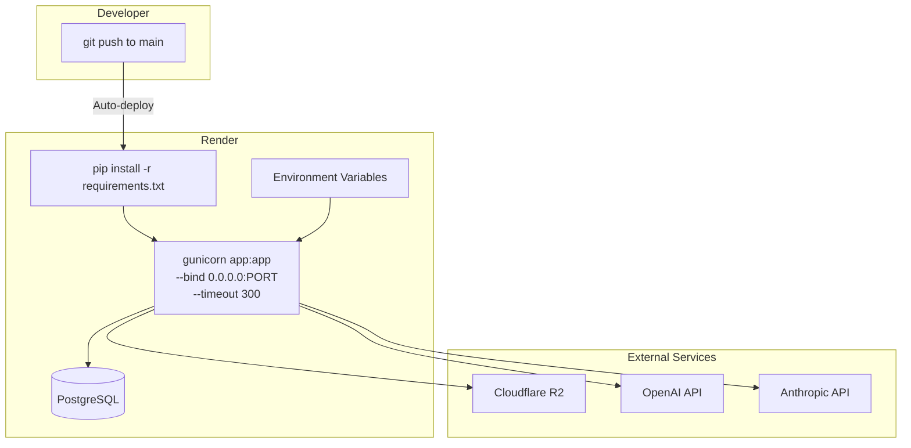

# Deployment and Operations

## Deployment Architecture



## Production (Render)

### Deployment Config

**render.yaml** (checked into repo):
```yaml
services:
  - type: web
    name: fencing-tips
    env: python
    buildCommand: pip install -r requirements.txt
    startCommand: gunicorn app:app --bind 0.0.0.0:$PORT --timeout 300
    envVars:
      - key: OPENAI_API_KEY
        sync: false
      - key: ANTHROPIC_API_KEY
        sync: false
```

**Procfile** (alternative):
```
web: gunicorn app:app --bind 0.0.0.0:$PORT --timeout 300
```

The 300-second gunicorn timeout accommodates long-running operations like video transcription and multi-photo DE bracket extraction.

### Deploy Process

1. Push to `main` branch
2. Render detects the push and auto-deploys (2-3 minutes)
3. `pip install -r requirements.txt` runs as the build step
4. gunicorn starts serving the app

There is no test suite, linter, or build step beyond dependency installation.

### Required Environment Variables (Render Dashboard)

| Variable | Notes |
|----------|-------|
| `DATABASE_URL` | Provided by Render PostgreSQL add-on. Uses `postgres://` prefix which the app rewrites to `postgresql://` for SQLAlchemy compatibility (database.py:311-322) |
| `OPENAI_API_KEY` | OpenAI API key for Whisper transcription |
| `ANTHROPIC_API_KEY` | Anthropic API key for Claude analysis |
| `R2_ACCOUNT_ID` | Cloudflare account ID |
| `R2_ACCESS_KEY_ID` | R2 API access key |
| `R2_SECRET_ACCESS_KEY` | R2 API secret key |
| `R2_BUCKET_NAME` | R2 bucket name (default: `fencing-lessons`) |
| `APP_PASSWORD` | Login password |
| `SECRET_KEY` | Flask session signing key (use a strong random value in production) |

### Database

Production uses PostgreSQL provided by Render. Key considerations:

- **Auto-create**: `Base.metadata.create_all(engine)` runs at import time, creating any new model tables automatically
- **Migrations**: Schema changes to existing tables require manual `ALTER TABLE` blocks in `database.py` (see the PostgreSQL-specific migration blocks at lines 330-404)
- **VARCHAR enforcement**: PostgreSQL enforces `VARCHAR(N)` limits that SQLite silently ignores. The migration block at line 330 widens `round_name` and `completeness` columns
- **No migration framework**: There is no Alembic or similar tool. Migrations are inline Python that runs on every startup and uses try/except to be idempotent

### File Handling

- **Upload limit**: 500MB (`MAX_CONTENT_LENGTH` at app.py:94)
- **Temp directory**: `uploads/` is created alongside `app.py` via `mkdir(exist_ok=True)`
- **Cleanup**: All uploaded files are deleted after processing in `finally` blocks, both on success and error paths. This prevents disk usage accumulation on the Render instance
- **Persistent storage**: All permanent files go to Cloudflare R2, not the local filesystem

## Local Development

### Setup

```bash
# Create and activate virtual environment
python -m venv venv
source venv/bin/activate

# Install dependencies
pip install -r requirements.txt

# Create .env file with API keys (DO NOT commit this file)
# Required: OPENAI_API_KEY, ANTHROPIC_API_KEY, APP_PASSWORD
# Optional: R2_* variables (only needed for video features)

# Run the app
python app.py
# Starts on http://localhost:5001
```

### Local Database

When `DATABASE_URL` is not set, the app falls back to SQLite at `fencing_data.db` in the project root (database.py:322). This file is gitignored and created automatically on first run.

SQLite differences from PostgreSQL:
- No `VARCHAR` length enforcement
- No `IF NOT EXISTS` for `ALTER TABLE ADD COLUMN` (pre-SQLite 3.35) -- the migration blocks use `PRAGMA table_info()` to check before altering
- No connection pooling concerns

### Dependencies

From `requirements.txt`:

| Package | Purpose |
|---------|---------|
| flask | Web framework |
| openai | Whisper API client |
| anthropic | Claude API client |
| python-dotenv | Load `.env` for local dev |
| moviepy | Video processing (fallback audio extraction) |
| psycopg2-binary | PostgreSQL driver |
| sqlalchemy | ORM |
| boto3 | S3-compatible client for Cloudflare R2 |
| gunicorn | WSGI server for production |
| thefuzz | Fuzzy string matching |
| python-Levenshtein | C extension for faster Levenshtein distance (used by thefuzz) |

### Video Processing

Audio extraction from videos uses a two-tier approach (app.py:131-172):

1. **Preferred**: Direct `ffmpeg` binary via `subprocess.run()` -- handles iPhone HEVC/Dolby Vision better than moviepy
2. **Fallback**: `moviepy.VideoFileClip` if ffmpeg is not available on PATH or via `imageio_ffmpeg`

For local development, install ffmpeg separately:
```bash
# macOS
brew install ffmpeg
```

## Maintenance

### Database Schema Changes

To add a new column to an existing table:

1. Add the column to the SQLAlchemy model in `database.py`
2. Add an inline migration block (similar to `_ensure_tournament_final_results_columns()` at line 372) that runs at import time
3. The migration block should:
   - Check if the column exists first (use `PRAGMA table_info()` for SQLite, `IF NOT EXISTS` for PostgreSQL)
   - Use `try/except` to be idempotent
   - Run for both PostgreSQL and SQLite

To add a new table: just add the model class. `Base.metadata.create_all(engine)` handles it automatically.

### Backup

The `/api/backup` endpoint exports all tips and sessions as a JSON file. This does NOT include tournaments, opponents, lessons, or scout data. For a full backup, use PostgreSQL's `pg_dump` on the Render database.

### Monitoring

There is no structured logging or monitoring. Errors from opponent sync are printed to stdout (visible in Render logs). The app does not use any APM or error tracking service.

### Security Notes

- **Authentication**: Single shared password. No user accounts, no RBAC
- **Session**: Flask session cookie with 1-day expiry. `SECRET_KEY` should be set to a strong random value in production
- **File uploads**: Filenames are sanitized via `werkzeug.secure_filename()`. Files are processed and immediately deleted
- **API keys**: Stored in environment variables, never in code. The `.env` file must never be committed
- **No CSRF protection**: The app does not use Flask-WTF or any CSRF tokens. This is acceptable for a single-user personal app but would need addressing for multi-user use
