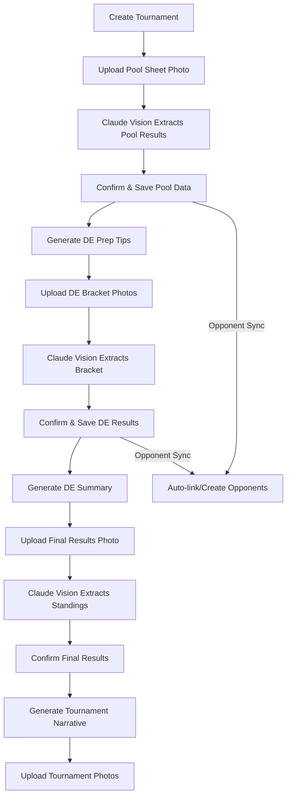
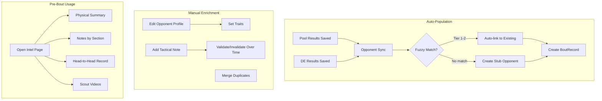
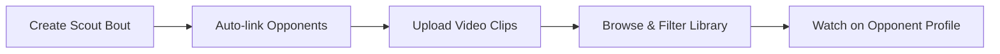

# Feature Guide

## 1. Coaching Tips (Voice Memo Analysis)

**What it does**: Upload a voice memo or video of coaching feedback. The app transcribes it, extracts actionable fencing tips, categorizes them, and accumulates a deduplicated tip library across all sessions.

**How it works**:
1. User uploads an audio file (.m4a, .mp3, .wav, etc.) or video file (.mp4, .mov, etc.)
2. If video, audio is extracted via ffmpeg (preferred) or moviepy fallback (app.py:131-172)
3. OpenAI Whisper transcribes the audio (app.py:175-197)
4. Post-processing fixes common fencing term mistranscriptions like "flash" to "fleche" (app.py:201-220)
5. Claude Sonnet extracts tips into 6 fixed categories (app.py:223-266)
6. Tips are saved with deduplication -- same tip text is never stored twice (database.py:459-498)

**Categories** (hardcoded invariant):
- `patience_and_control`
- `distance_management`
- `reading_opponent`
- `when_ahead`
- `attack_execution`
- `defense_and_retreat`

**Files involved**: `app.py` (routes + AI prompts), `database.py` (Session/Tip models + CRUD), `templates/tips.html`

## 2. Private Lessons (Video Library)

**What it does**: Upload and manage private lesson videos with R2 storage, automatic transcription, AI-powered analysis (title, summary, category, tags), and searchable/filterable library.

**How it works**:
1. Video uploaded to temp storage, then to Cloudflare R2 (app.py:473-591)
2. Audio extracted and sent to Whisper for transcription
3. Claude analyzes transcript to auto-generate: title, summary, offense/defense category, technique tags (app.py:269-301)
4. User-provided metadata merges with auto-generated values (user input takes priority)
5. Presigned R2 URLs generated for playback (1-hour expiry)

**Filtering**: By category (offense/defense), by tag, or by free-text search across title/description/transcript (database.py:1147-1178).

**Files involved**: `app.py` (upload/CRUD routes), `database.py` (Lesson/LessonTag models), `templates/lessons.html`

## 3. Tournament Tracking

**What it does**: Full tournament lifecycle tracking: create tournament, upload pool sheet photo for AI extraction, generate DE prep tips, upload DE bracket photos, generate performance analysis, upload final results, and get an AI-written tournament narrative.

**Tournament Detail Page sections**:
1. Tournament info (name, date, location, weapon, age category)
2. Pool results (extracted from photo or entered manually)
3. DE prep tips (AI-generated from pool data)
4. DE bracket results (extracted from photo)
5. DE performance summary (AI-generated)
6. Final results and tournament narrative
7. Tournament photos

**Files involved**: `app.py` (all tournament routes), `database.py` (Tournament + 7 related models), `de_extraction.py`, `final_results_extraction.py`, `templates/tournaments.html`, `templates/tournament_detail.html`

### 3a. Pool Sheet Photo Extraction

Claude Vision reads the pool grid format: D/V scores, opponent names/clubs, summary statistics. The detailed prompt (app.py:785-854) explains how to read fencing pool grids, handle empty/partial/complete states, and interpret D (defeat) and V (victory) notations.

### 3b. DE Bracket Photo Extraction

Multi-photo support via `de_extraction.py`. The system:
1. Sends each photo to Claude Vision with a detailed bracket-reading prompt (de_extraction.py:156-265)
2. Merges results deterministically in Python (no second Claude call) using `merge_de_bracket_extractions()` (de_extraction.py:320-420)
3. Handles: round-name canonicalization, BYE prepending for top seeds, duplicate opponent removal, best-bout-per-round selection, final placement derivation

### 3c. DE Prep Tips

After pool results are saved, Claude generates 5 prioritized tactical tips for the upcoming DE rounds (app.py:1111-1167). Tips are specific to the pool data patterns (close losses, blowouts, scoring trends) and use epee-specific terminology.

### 3d. Tournament Narrative

After final results are confirmed, Claude generates a 2-4 sentence prose summary covering pool performance, DE results, final placement, and one concrete takeaway (app.py:1386-1491).

## 4. Opponent Intelligence

**What it does**: Build a scouting database of opponents with physical traits, tactical notes (with validation tracking), head-to-head records, and pre-bout intel briefings.

**Components**:

### Opponent Directory
- Create/edit opponent profiles with traits: handedness, height category, build, speed rating, primary/secondary style
- USFA name format: "LASTNAME Firstname"
- Name and club aliases for fuzzy matching across tournaments
- Merge duplicate opponents (combines all data)

### Tactical Notes
- Per-opponent observations categorized as: `what_worked`, `favorite_action`, `tell`, `weakness`
- Validation system: thumbs-up/down counters with computed confidence ratio
- Source tracking (manual vs future automated)

### Head-to-Head Records
- Automatically created when pool/DE results are saved via opponent sync
- Aggregate stats: wins, losses, total touches for/against
- Links back to specific tournament bouts and their videos

### Pre-Bout Intel Page
- Phone-optimized "glance" view for checking before a bout
- Shows: physical summary, notes by section (what works / watch out for / weaknesses), last encounter details, head-to-head record, related scout videos

**Files involved**: `app.py` (opponent routes), `database.py` (Opponent/OpponentTacticalNote/BoutRecord models + CRUD), `fuzzy_matching.py`, `templates/opponents.html`, `templates/opponent_profile.html`, `templates/opponent_intel.html`

## 5. Fuzzy Opponent Matching

**What it does**: Matches opponent names and clubs from photo extractions against the existing opponent database using a four-tier confidence system.

**Tier system** (fuzzy_matching.py:96-201):

| Tier | Confidence | Criteria | Action |
|------|-----------|----------|--------|
| 1 | Exact | Exact name AND exact club | Auto-link |
| 2 | High | Name score >= 85 AND exact club | Auto-link |
| 3 | Medium | Name score >= 70 AND club score >= 70 | Confirm (user decides) |
| 4 | Low | Name score >= 80 AND one side has no club | Confirm (user decides) |
| -- | None | No match above thresholds | Create new opponent |

**Scoring**: Uses three metrics per comparison -- `fuzz.ratio`, `fuzz.token_sort_ratio`, `fuzz.partial_ratio` -- and takes the max. This handles name format variations ("SALIM Ethan" vs "Ethan Salim" vs "SALIM, Ethan").

**Files involved**: `fuzzy_matching.py` (core matching logic), `database.py` (sync integration + lookup helpers)

## 6. Bout Library (Scouting Videos)

**What it does**: A video library for scouting bouts -- record and study other fencers' bouts, tag them, attach to opponents, and filter by tournament/opponent/tag.

**How it works**:
1. Create a scout bout entry with two fencer names, optional tournament context, round, score, notes, and tags
2. Auto-links fencer names to opponent records (Tier 1/2 match) or creates stubs
3. Upload one or more video clips per bout to R2
4. Browse/filter the library by tournament, opponent, or tag

**Files involved**: `app.py` (scout bout routes), `database.py` (ScoutBout/ScoutVideo models), `templates/bout_library.html`

## 7. Bout Videos (Pool and DE)

**What it does**: Attach video recordings to specific pool bouts or DE elimination rounds within a tournament.

**How it works**:
- Multiple videos per bout (replaces the legacy single-video column)
- Videos stored in R2 with key format `bout-videos/{kind}_{bout_id}_{uuid}.ext`
- Presigned URLs generated for playback (1-hour expiry)
- Videos display on tournament detail page alongside bout data
- Also visible on opponent profiles via head-to-head records

**Files involved**: `app.py` (bout video routes), `database.py` (BoutVideo model)

## 8. Backup and Restore

**What it does**: Export all tips and sessions as a downloadable JSON file, and restore from a backup file.

**How it works**:
- `GET /api/backup` returns a JSON file with all sessions and combined advice
- `POST /api/restore` accepts a JSON backup file, skips duplicates, and restores any missing data
- Does not cover tournament, opponent, or lesson data (tips/sessions only)

**Files involved**: `app.py` (backup/restore routes), `database.py` (`load_data_from_db`, `restore_data_to_db`)
