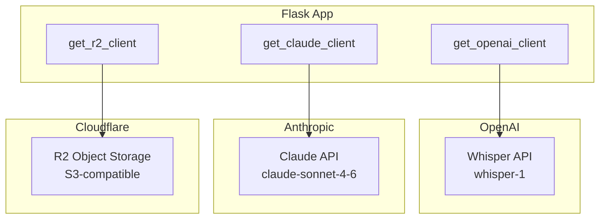

# External Service Integrations

## Overview

The app integrates with three external services, all initialized lazily to avoid crashing on startup when environment variables are not yet available.



## 1. OpenAI Whisper (Transcription)

**Purpose**: Transcribe audio from coaching voice memos and lesson videos.

**Client initialization** (app.py:106-110):
```python
def get_openai_client():
    global _openai_client
    if _openai_client is None:
        _openai_client = openai.OpenAI(api_key=os.environ["OPENAI_API_KEY"])
    return _openai_client
```

**Usage points**:
- `transcribe()` (app.py:175-197) -- Used for both voice memo uploads and lesson video uploads
- Model: `whisper-1`
- Response format: `text` (plain text transcript)

**Post-processing** (app.py:200-220):
The `_fix_fencing_terms()` function corrects common Whisper mistranscriptions of fencing terminology:
- "flash" / "flesh" / "fleche" --> "fleche"
- "circle sticks" --> "circle six"
- "repost" --> "riposte"
- "on guard" --> "en garde"
- "touche" --> "touche"

**Error handling**: Exceptions propagate to the caller. The upload route (app.py:363-388) catches all exceptions, cleans up the temp file, and returns a 500 error.

**Environment variable**: `OPENAI_API_KEY`

## 2. Anthropic Claude (AI Analysis and Vision)

**Purpose**: Multiple AI analysis tasks using Claude Sonnet 4.6, including text analysis and computer vision for photo extraction.

**Client initialization** (app.py:112-116):
```python
def get_claude_client():
    global _claude_client
    if _claude_client is None:
        _claude_client = anthropic.Anthropic(api_key=os.environ["ANTHROPIC_API_KEY"])
    return _claude_client
```

Note: `de_extraction.py` and `final_results_extraction.py` each maintain their own lazy client instances with the same pattern.

**Model**: `claude-sonnet-4-6` (used consistently across all prompts)

### Claude Usage Points

| Function | File:Line | Purpose | Max Tokens | Input |
|----------|-----------|---------|------------|-------|
| `extract_fencing_advice()` | app.py:223 | Extract categorized tips from transcript | 2048 | Text transcript |
| `analyze_lesson_transcript()` | app.py:269 | Generate title/summary/category/tags | 512 | Text transcript |
| `extract_pool_results_from_photo()` | app.py:754 | Read pool sheet grid | 2048 | Base64 image |
| `generate_de_prep_tips()` | app.py:1111 | 5 tactical tips from pool data | 1024 | Pool results text |
| `generate_de_summary()` | app.py:1200 | DE performance analysis | 1536 | DE bout results text |
| `_generate_tournament_narrative()` | app.py:1386 | 2-4 sentence tournament summary | 512 | Pool + DE + standings text |
| `extract_de_bracket_from_photo()` | de_extraction.py:156 | Read DE bracket from photo | 4096 | Base64 image |
| `extract_final_results()` | final_results_extraction.py:77 | Read final standings from photo | 3072 | Base64 image(s) |

### Vision API Usage Pattern

All photo extraction functions follow the same pattern:
1. Read image file, base64-encode it
2. Determine media type from file extension (.jpg, .png, .webp)
3. Send as a `messages.create()` call with `image` + `text` content blocks
4. Parse JSON from response, handling markdown code fence wrapping

The `_parse_json_response()` helper (present in both `de_extraction.py` and `final_results_extraction.py`) strips ```` ```json ```` fences if Claude wraps its response.

### Prompt Design

**Pool sheet prompt** (app.py:785-854): Extremely detailed instructions for reading fencing pool grids, including:
- How D/V notation works
- Three pool states (empty, partial, complete)
- Cross-referencing opponent rows for victory scores
- Summary statistics columns (V, V/M, TS, TR, Ind)

**DE bracket prompt** (de_extraction.py:179-258): Step-by-step bracket reading instructions covering:
- Left-to-right bracket flow
- Score placement rules (score appears in column N+1 next to winner)
- Bracket size determination from leftmost column header
- Prohibition on extracting rightmost-column bouts (result not visible)
- Validation rules (each round must have a different opponent)

**Error handling**: All Claude calls are wrapped in try/except. JSON parsing has fallback logic to strip markdown code fences. Specific functions handle different failure modes:
- Pool/DE extraction: errors return to user for retry
- Opponent sync: errors logged but never abort the save
- Narrative generation: errors reported separately from data save

**Environment variable**: `ANTHROPIC_API_KEY`

## 3. Cloudflare R2 (Object Storage)

**Purpose**: Store video files (lessons, bout videos, scout videos) and tournament photos. Replaces an earlier YouTube-based approach for lesson videos.

**Client initialization** (app.py:118-128):
```python
def get_r2_client():
    global _r2_client
    if _r2_client is None:
        import boto3
        _r2_client = boto3.client('s3',
            endpoint_url=f"https://{os.environ.get('R2_ACCOUNT_ID', '')}.r2.cloudflarestorage.com",
            aws_access_key_id=os.environ.get('R2_ACCESS_KEY_ID', ''),
            aws_secret_access_key=os.environ.get('R2_SECRET_ACCESS_KEY', ''),
            region_name='auto'
        )
    return _r2_client
```

### R2 Key Patterns

| Content Type | Key Pattern | Example |
|-------------|-------------|---------|
| Lesson videos | `lessons/{uuid}.ext` | `lessons/a1b2c3d4.mp4` |
| Bout videos | `bout-videos/{kind}_{bout_id}_{uuid}.ext` | `bout-videos/pool_42_e5f6.mp4` |
| Scout videos | `scout/{bout_id}_{uuid}.ext` | `scout/7_g8h9.mov` |
| Tournament photos | `tournament-photos/{tournament_id}/{uuid}.ext` | `tournament-photos/3/i0j1.jpg` |

### Operations Used

| Operation | boto3 Method | Where Used |
|-----------|-------------|------------|
| Upload | `upload_file()` | Lesson upload, bout video upload, scout video upload, tournament photo upload |
| Download URL | `generate_presigned_url('get_object')` | Video playback, photo display (1-hour expiry) |
| Delete | `delete_object()` | Lesson delete, bout video delete, scout video delete, tournament photo delete, tournament cascade delete |

### Presigned URL Pattern

All playback/display endpoints generate presigned GET URLs with:
- 1-hour expiry (`ExpiresIn=3600`)
- Explicit `ResponseContentType` header matching the file's MIME type
- Bucket name from `R2_BUCKET_NAME` env var (default: `fencing-lessons`)

### Error Handling

R2 operations follow a "best-effort cleanup" pattern:
- **Upload failures**: propagate to caller (upload is the primary operation)
- **Delete failures on cascade**: swallowed with a log message -- DB rows are already deleted, so stale R2 objects are acceptable (app.py:1043, 1730, etc.)
- **Delete failures on explicit delete**: swallowed -- the DB row is the source of truth

**Environment variables**:
- `R2_ACCOUNT_ID`
- `R2_ACCESS_KEY_ID`
- `R2_SECRET_ACCESS_KEY`
- `R2_BUCKET_NAME` (default: `fencing-lessons`)

## Environment Variables Summary

| Variable | Required | Service | Purpose |
|----------|----------|---------|---------|
| `OPENAI_API_KEY` | Yes (for transcription) | OpenAI | Whisper API authentication |
| `ANTHROPIC_API_KEY` | Yes (for AI features) | Anthropic | Claude API authentication |
| `R2_ACCOUNT_ID` | Yes (for video/photo storage) | Cloudflare | R2 endpoint URL |
| `R2_ACCESS_KEY_ID` | Yes (for video/photo storage) | Cloudflare | R2 auth key |
| `R2_SECRET_ACCESS_KEY` | Yes (for video/photo storage) | Cloudflare | R2 auth secret |
| `R2_BUCKET_NAME` | No (default: `fencing-lessons`) | Cloudflare | R2 bucket name |
| `DATABASE_URL` | Yes (prod) | PostgreSQL | DB connection string |
| `APP_PASSWORD` | Yes | Auth | Shared login password |
| `SECRET_KEY` | No (has default) | Flask | Session signing key |
| `DEFAULT_FENCER_NAME` | No (default: `SALIM Ethan`) | App | Fencer name for extractions |
| `PORT` | No (default: `5001`) | App | Server port |
