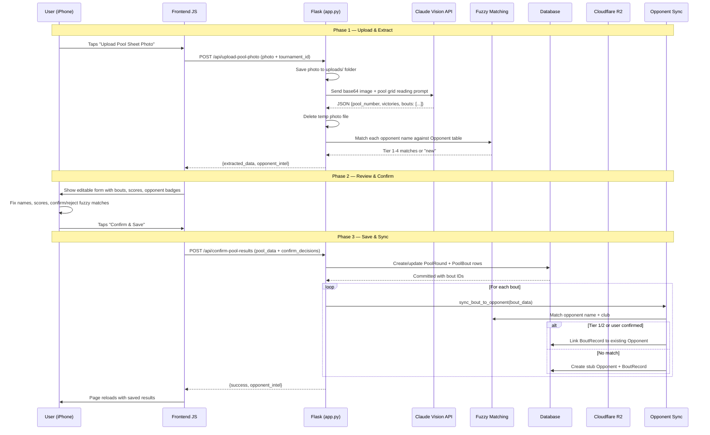
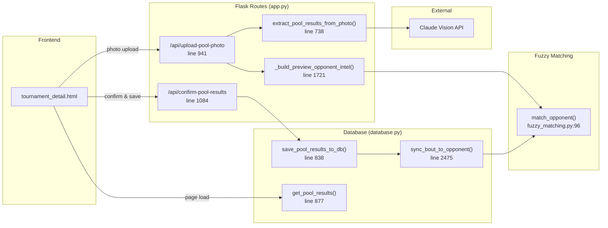
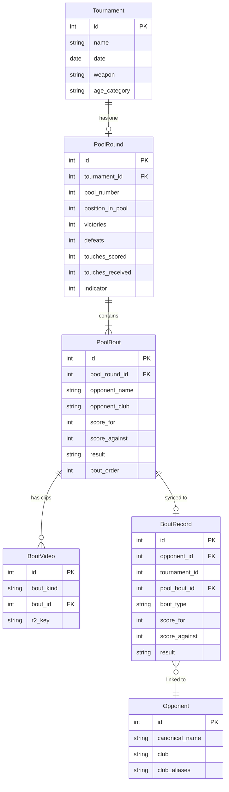
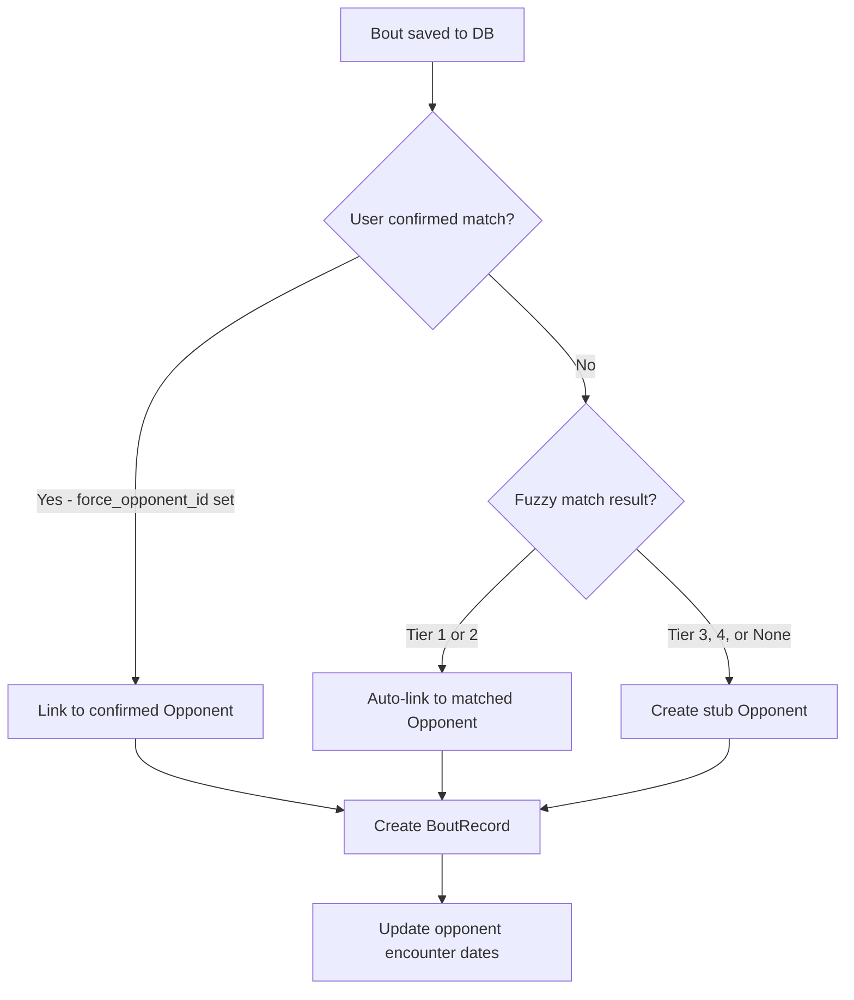
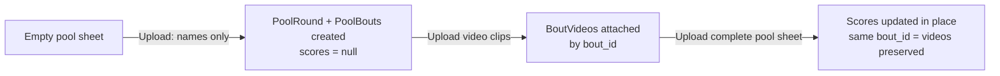

# Pool Bout Upload — Complete Flow

This document traces the full lifecycle of uploading a pool sheet photo, from the user tapping "Upload" to the data being saved and opponents linked.

## Overview Diagram



## Files Involved



## Database Models



## Step-by-Step Detail

### 1. Photo Upload (`app.py:941`)

User selects a photo on iPhone. JS sends it as multipart form data:

```
POST /api/upload-pool-photo
Content-Type: multipart/form-data
- photo: [image file]
- tournament_id: 5
```

The endpoint saves the file to `uploads/`, calls `extract_pool_results_from_photo()`, then deletes the temp file in a `finally` block (both success and error paths).

### 2. Claude Vision Extraction (`app.py:738`)

The photo is base64-encoded and sent to `claude-sonnet-4-6` with `max_tokens=2048`. The prompt (`app.py:785-854`) explains:
- How to read a fencing pool grid (rows = fencers, columns = bout results)
- D4 means the row fencer lost and scored 4 touches
- V5 means the row fencer won and scored 5 touches
- How to handle empty, partial, and complete pool sheets
- Extract from SALIM Ethan's row only

Returns JSON with `pool_number`, `victories`, `defeats`, `indicator`, and a `bouts` array with each opponent's name, club, and score.

### 3. Opponent Preview (`app.py:1721`)

Before showing results to the user, each opponent name is fuzzy-matched against the existing `Opponent` table using `thefuzz` (4-tier system in `fuzzy_matching.py`):

| Tier | Confidence | Criteria | Action |
|------|-----------|----------|--------|
| 1 | Exact | Exact name + exact club | Auto-link |
| 2 | High | Name >= 85 + exact club | Auto-link |
| 3 | Medium | Name >= 70 + club >= 70 | Show confirm button |
| 4 | Low | Name >= 80 + one club missing | Show confirm button |
| None | — | Below thresholds | Create new |

### 4. User Review (Frontend JS)

`populateExtractedResults()` renders an editable form with:
- Each bout as a card with editable name, club, score fields
- Intel badges: green (known), yellow with Yes/No buttons (confirm?), grey (new)
- User can fix OCR errors before saving

### 5. Confirm & Save (`database.py:838`)

`save_pool_results_to_db()` handles both first upload and re-upload:

**First upload:** Creates new `PoolRound` + `PoolBout` rows.

**Re-upload (updating scores):** Matches incoming bouts to existing `PoolBout` rows by opponent name (case-insensitive). Updates scores in place, preserving the same `bout_id` — this keeps `BoutVideo` clips attached.

### 6. Opponent Sync (`database.py:2475`)

After pool data is committed, each bout is synced to an `Opponent` record:



The sync runs outside the main DB transaction — if it fails, the pool data is still saved. Each sync creates a `BoutRecord` that links the `PoolBout` to an `Opponent`, enabling the head-to-head view on opponent profiles.

### 7. Re-upload Flow



Key: the `bout_id` stays the same across re-uploads, so video clips remain attached to the correct opponent's bout.
